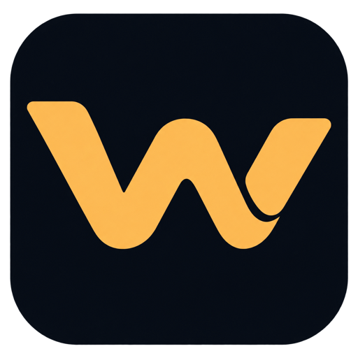

# Vibe Coding Workflow



[Vibe Coding Toolkit](https://github.com/soumatheusgomes/vibe-coding-toolkit), packaged for your coding agent.

**Early development.** Codex has opt-in task controls, read-only diagnostics and shared schema-2 worker/check/review ownership. Recorded [D2](docs/d2-validation.md) and [D5](docs/d5-validation.md) qualification covers bounded CLI/bundled app-server behavior, a controlled Interrupt case, Desktop startup orientation and the earlier D5 lifecycle at their stated versions and pins. It does not qualify the new schema-2 native lifecycle. General guard/continuation turn correlation, other desktop behavior and Claude lifecycle remain unqualified. See the [client contracts](clients/index.md) for local procedures.

Ordinary editing, checks, review and handoff use the [native workflow](clients/codex.md#startup-behavior) and applicable [shared policies](policies/00-index.md). For explicitly selected managed task controls, read [task runtime](clients/runtime.md); for managed checks, review and completion, load [evidence](clients/evidence.md); for managed worker assignments, load [delegation](clients/delegation.md). Local readiness covers current task evidence and grants no merge authority. D7's [bounded fixture inspector](clients/repository-gate.md) is implemented but always exits 1; production evidence sources, publishing and repository enforcement remain unqualified.

Enable [Workstreams](skills/workstreams/SKILL.md) during project onboarding or ask
the skill to **enable**, **disable** or show **status** for this project. Both use
one saved Enabled/Disabled checkbox in project guidance. Enabled automatically
uses suitable native child work; small tasks can stay with the coordinator. This
choice needs no runtime database or separate activation. Resource admission and
capacity recovery keep their separate advanced controls and prerequisites.
[Thread Naming](clients/workstreams-naming.md) starts automatically with
implementation, including solo work, independently of delegation and these
features. Question-only and planning chats stay untouched. Manual-title overrides
remain protected. See the [main-runtime boundary](docs/workstreams-main-port.md).

Use [Review my Project](skills/review-my-project/SKILL.md) to review selected repositories against their own project rules. It runs only the local checks it can confirm are safe and returns findings in chat; it needs no enrollment or database, and it never installs tools or applies fixes without your separate approval.

Use the separate [Manage Observability Integration](skills/manage-observability/SKILL.md) skill for optional observability requests. Langfuse is the first provider; exports are metrics-only and collection stays off. Connection controls use the current canonical checkout and private consent; local task preparation uses current task states. Required local evidence stays intact. Native collection and live execution remain separately qualified; see the [port boundary](docs/d9-observability-preparation.md#selective-port-to-current-main).

Observability activation stays outside project onboarding; successful onboarding may propose the separate skill as an optional follow-up.

Use [Manage API Usage](skills/manage-usage-routing/SKILL.md) for OpenAI credit
usage, spending limits and opt-in
API proposals in enrolled Codex checkouts. Routing defaults to OFF.

To opt in, open the project checkout in Codex and ask **“Enable Smart Balance
for this project”** or **“Enable Manual Usage Routing for this project.”**
Existing compatible account setup is reused. If several setups apply, select one;
connect an OpenAI project key only when a new connection is needed. Each checkout
needs explicit activation and its own task/data permission. The API project is
separate from your local repository. Activation saves the selected mode,
task scope and funding policy, including any spending caps you choose. Manual
uses the API for tasks you select. Smart Balance chooses eligible tasks within
the approved scope. Each live request
checks funding, budget and independent review. Ask **“Disable Usage Routing for
this project”** to stop new requests.

See the [routing controls](skills/manage-usage-routing/references/procedure.md)
and the [optional comparison template](docs/superpowers/specs/2026-10-31-usage-routing-design.md#paired-comparison-template).

## Prepare your Workspace

Open this checkout in a coding agent with terminal access to the destination machine:

```text
Read skills/prepare-my-workspace/SKILL.md and use it to prepare this machine.
```

For Codex releases, register the Git-backed marketplace:

```sh
codex plugin marketplace add https://github.com/fcoouto/vibe-workflow.git --ref codex/marketplace-release
```

In Codex Desktop, select **Vibe Coding Workflow**, install `vibe-workflow`, and invoke `prepare-my-workspace`. For later releases, use **Upgrade** in the Marketplace tab or run `codex plugin marketplace upgrade vibe-workflow-local`. Start a new chat to load the updated plugin.

For local plugin testing, install a clean export as described in [Development](#development), in a separate Codex profile. The local source uses the same marketplace ID, and Codex's **Upgrade** requires a Git source. See [OpenAI's marketplace guide](https://developers.openai.com/plugins/build/plugins#add-a-marketplace-from-the-cli).

For Claude Code local testing, launch `claude --plugin-dir .` from this checkout. See the [Claude Code contract](clients/claude-code.md) for loading and qualification.

## Enroll a project

For an explicitly selected existing project, use [onboard-my-project](skills/onboard-my-project/SKILL.md) to prepare a private plan, apply authorized configuration, activate qualified managed behavior, or undo owned changes. Configuration completes independently of runtime creation and native qualification. Canonical operations use the verified coordinator entry; the JSON CLI is for retained schema-1 requests. See [application and recovery](skills/onboard-my-project/references/apply-and-recovery.md). Package validation and actual client execution remain separate.

## Development

Requires Git and Python 3.11+. There is no package manager, linter or CI.

Install the plugin for both clients from a clean export of this checkout, never from the checkout itself:

```text
python3 -B scripts/package.py
codex plugin marketplace add ~/.cache/vibe-workflow/dev-package
codex plugin add vibe-workflow@vibe-workflow-local
claude plugin marketplace add ~/.cache/vibe-workflow/dev-package
claude plugin install vibe-workflow@vibe-workflow-local
```

Clients copy the whole source folder, including ignored local files and Git history, so the export holds only tracked files (stage new files first). Each run replaces the previous build and passes package validation. `--prune-caches` also removes cached copies no client still uses; with `--dry-run` it lists them instead, while the build still runs. A project whose instructions link into a removed cached copy needs onboarding again.

Restart Codex afterwards. To refresh after changes, rerun `python3 -B scripts/package.py`, then reinstall (`codex plugin remove` then `add`; `claude plugin uninstall` then `install`). Codex asks to approve the changed hooks again.

Checks: `python3 -B scripts/validate.py` (package only, a minute or less) and `python3 -B -m unittest discover -s tests` (full suite; takes many minutes). Neither establishes live client behavior.

Setup record, decisions and undo location: [docs/setup.md](docs/setup.md).

[Development guide](AGENTS.md)
